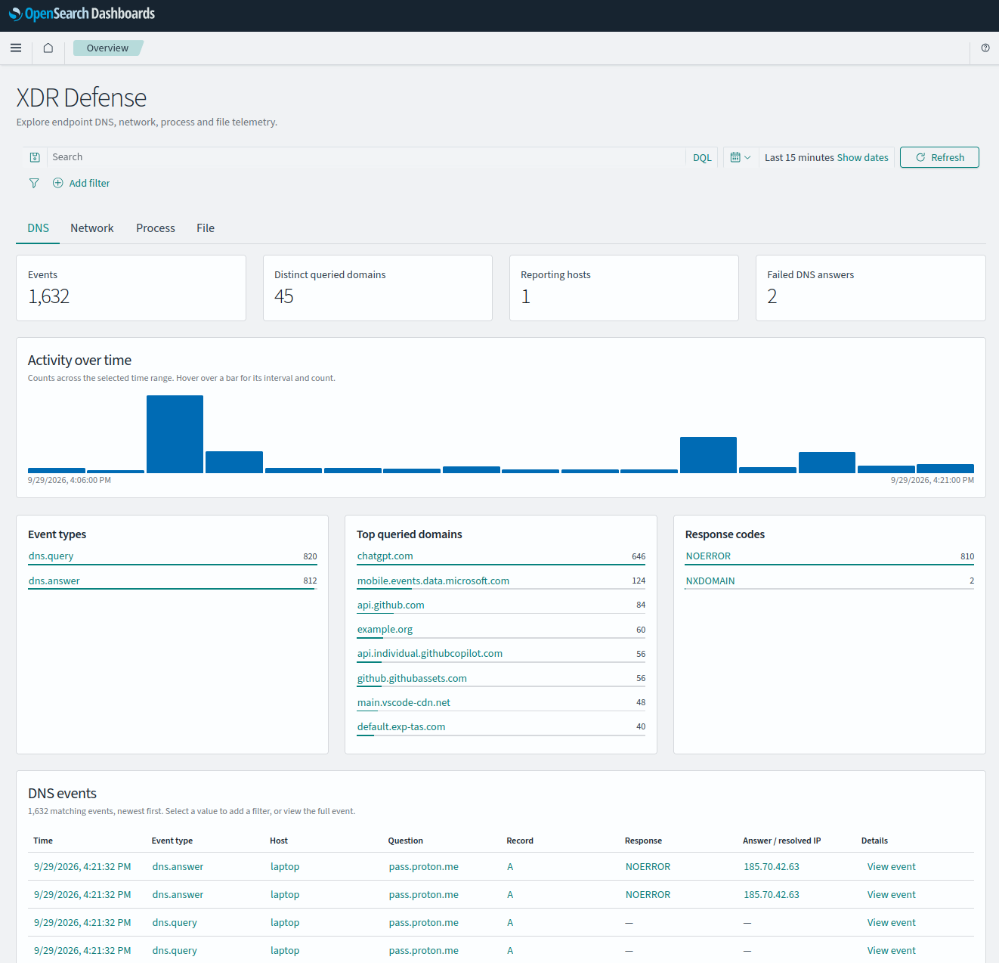

# XDR Defense

XDR Defense is a read-only OpenSearch Dashboards plugin for XDR Agent telemetry in the `xdr-agent-telemetry` data stream and legacy `.xdr-agent-telemetry-*` indices. DNS, Network, Process, and File tabs show activity, key metrics, breakdowns, and recent events. File includes access and integrity events.



The time picker, KQL search, and filter pills apply to every tab. Click chart or table values to add filters; open an event to inspect its Table or JSON view. The read API is `POST /api/xdr-defense/telemetry/search`.
Event details include the full document and returned metadata such as `_index`, `_id`, and `_score`.

## Install

Build against the same OpenSearch Dashboards version you run. The build uses the adjacent `OpenSearch-Dashboards` source checkout.

```bash
npm run build -- --opensearch-dashboards-version 3.8.0
/path/to/opensearch-dashboards/bin/opensearch-dashboards-plugin install "file://$(realpath build/xdrDefense-3.8.0.zip)"
```

Restart Dashboards and open `/app/xdrDefense`. For this workspace's Docker deployment, see [the local stack guide](../opensearch/README.md).

## License

XDR Defense is free software under [GNU AGPLv3](LICENSE), which requires sharing source code when distributed or when modified versions serve remote users.

- **Usage:** use, modify, redistribute, and sell it, including cloud hosting, while following the license.
- **Distribution:** share the complete source code with recipients, including your changes and build files, using a method permitted by AGPLv3.
- **Network use (§13):** if you run a modified version, prominently offer every remote user free access to its complete source code, even without distribution.
- **Copyleft:** keep covered modified versions under AGPLv3, preserve notices, and identify your changes. Dependencies retain their own licenses.
- **Warranty:** provided without warranty; liability is limited as specified in the license.

> Sharing source code with the required users is mandatory.
